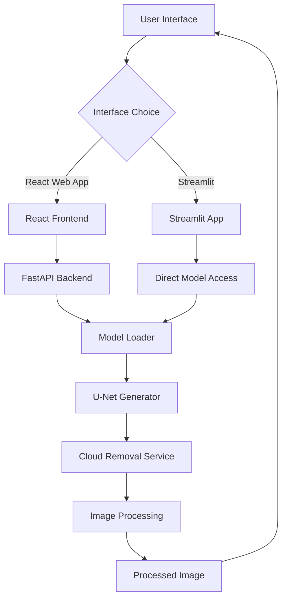

# CLEAR - Cloud-Less Earth Observation & Reconstruction

Modern AI-powered cloud removal system for satellite imagery using U-Net GAN architecture with multiple interface options.

## Overview

CLEAR transforms cloudy satellite imagery into clear, actionable data using advanced deep learning techniques. The project provides multiple interface options for cloud removal inference:

- **FastAPI Backend + React Frontend**: A modern web application with a React.js frontend and FastAPI backend for production deployment
- **Streamlit Interface**: A standalone Python application for quick local experimentation and model testing

### Key Features

- **AI-Powered Cloud Removal**: U-Net Generator architecture trained on satellite imagery datasets
- **Multiple Interface Options**: Choose between a modern React web app or a Streamlit interface
- **Model Support**: Pre-trained models (RICE1, RICE2) for diverse cloud patterns
- **Real-time Processing**: Fast image processing with GPU acceleration support
- **Visual Comparison**: Interactive before/after image comparison tools
- **Responsive Design**: React frontend works seamlessly on desktop, tablet, and mobile

## Architecture

```
CLEAR/
├── backend/                 # FastAPI backend application
│   ├── app/
│   │   ├── main.py         # FastAPI application entry point
│   │   ├── api/            # API routes
│   │   │   └── routes.py   # Health, models, process endpoints
│   │   ├── models/         # Model architecture and loader
│   │   │   ├── model_loader.py
│   │   │   └── unet_generator.py
│   │   ├── services/       # Business logic
│   │   │   └── cloud_removal_service.py
│   │   ├── schemas/        # Pydantic schemas
│   │   │   └── requests.py
│   │   └── utils/          # Utility functions
│   │       └── image_processing.py
│   ├── models/             # Trained model weights
│   │   ├── RICE1_Best.pth
│   │   └── RICE2_Best.pth
│   ├── requirements.txt    # Backend dependencies
│   └── .env                # Backend environment variables
│
├── frontend/                 # React.js frontend application
│   ├── src/
│   │   ├── components/     # React components
│   │   │   ├── Common/     # Shared components (Button, LoadingSpinner, ModelSelector)
│   │   │   ├── Layout/     # Layout components (Header, Footer, Sidebar)
│   │   │   ├── Results/    # Result display components
│   │   │   └── Upload/     # Upload components
│   │   ├── pages/          # Page components (Home, About, Documentation)
│   │   ├── services/       # API integration
│   │   │   └── api.js
│   │   ├── hooks/          # Custom React hooks
│   │   ├── utils/          # Utility functions
│   │   ├── styles/         # Global styles
│   │   ├── App.jsx         # Main React application
│   │   └── index.js        # Entry point
│   ├── public/             # Static assets
│   ├── package.json        # Frontend dependencies
│   └── .env                # Frontend environment variables
│
├── app.py                   # Streamlit interface (alternative to React)
├── README.md
└── pitch.md
```

## System Architecture



## Technology Stack

### Backend
- **FastAPI 0.104.1**: Modern Python web framework
- **PyTorch 2.0.1**: Deep learning framework
- **Uvicorn 0.24.0**: ASGI server
- **Pillow 10.0.0**: Image processing
- **OpenCV 4.8.0.74**: Computer vision utilities
- **NumPy 1.24.3**: Numerical computing
- **scikit-image 0.22.0**: Image processing algorithms
- **python-dotenv 1.0.0**: Environment variable management
- **pydantic 2.5.0**: Data validation
- **aiofiles 23.2.1**: Async file operations

### Frontend (React)
- **React 18.2.0**: UI framework
- **React Router 6.20.0**: Client-side routing
- **Tailwind CSS 3.3.6**: Utility-first styling
- **Axios 1.6.2**: HTTP client
- **Framer Motion 10.16.16**: Animations
- **React Dropzone 14.2.3**: File upload
- **React Hot Toast 2.4.1**: Notifications
- **React Compare Image 3.1.0**: Image comparison
- **React Loader Spinner 5.4.5**: Loading indicators

### Streamlit Interface
- **Streamlit**: Python web framework for ML apps
- **PyTorch**: Deep learning framework
- **Pillow**: Image processing

### AI/ML
- **U-Net Generator**: 41.8M parameters, encoder-decoder architecture with skip connections
- **Transfer Learning**: RICE1 → RICE2 training strategy
- **PyTorch**: Model implementation and inference

## Prerequisites

- **Python**: 3.8 or higher
- **Node.js**: 16+ and npm (for React frontend)
- **CUDA-capable GPU**: Recommended for faster inference (optional, CPU fallback available)
- **4GB+ GPU memory**: Recommended for GPU inference (optional)

## Installation and Setup

### Option 1: React Frontend + FastAPI Backend

#### Backend Setup

```bash
cd backend

# Create virtual environment
python -m venv venv

# Activate virtual environment
# On Windows:
venv\Scripts\activate
# On macOS/Linux:
source venv/bin/activate

# Install dependencies
pip install -r requirements.txt

# Configure environment variables
# Edit .env file with your settings
# MODEL_PATH=./models
# RICE1_MODEL=RICE1_Best.pth
# RICE2_MODEL=RICE2_Best.pth
# MAX_IMAGE_SIZE=1024
# CUDA_DEVICE=0
# API_HOST=0.0.0.0
# API_PORT=8000
```

#### Frontend Setup

```bash
cd frontend

# Install dependencies
npm install

# Configure environment variables
# Edit .env file with your settings
# REACT_APP_API_URL=http://localhost:8000
# REACT_APP_API_TIMEOUT=30000
# REACT_APP_MAX_FILE_SIZE=10485760
```

#### Running the Application

**Start Backend:**
```bash
cd backend
uvicorn app.main:app --host 0.0.0.0 --port 8000 --reload
```

**Start Frontend:**
```bash
cd frontend
npm start
```

**Access the Application:**
- Frontend: http://localhost:3000
- Backend API: http://localhost:8000
- API Documentation: http://localhost:8000/docs

### Option 2: Streamlit Interface

The Streamlit interface provides a standalone alternative that doesn't require the FastAPI backend.

```bash
# Install dependencies (including streamlit)
pip install streamlit torch torchvision pillow numpy

# Ensure model files are in the models/ directory
# Place RICE1_Best.pth and/or RICE2_Best.pth in the models/ folder

# Run the Streamlit app
streamlit run app.py
```

The Streamlit interface will open automatically in your browser.

## Environment Variables

### Backend Environment Variables

| Variable | Required | Purpose | Default |
|----------|----------|---------|---------|
| `MODEL_PATH` | No | Path to model weights directory | `./models` |
| `RICE1_MODEL` | No | Filename for RICE1 model | `RICE1_Best.pth` |
| `RICE2_MODEL` | No | Filename for RICE2 model | `RICE2_Best.pth` |
| `MAX_IMAGE_SIZE` | No | Maximum image dimension | `1024` |
| `CUDA_DEVICE` | No | CUDA device index | `0` |
| `API_HOST` | No | API server host | `0.0.0.0` |
| `API_PORT` | No | API server port | `8000` |

### Frontend Environment Variables

| Variable | Required | Purpose | Default |
|----------|----------|---------|---------|
| `REACT_APP_API_URL` | No | Backend API URL | `http://localhost:8000` |
| `REACT_APP_API_TIMEOUT` | No | API request timeout (ms) | `30000` |
| `REACT_APP_MAX_FILE_SIZE` | No | Maximum upload file size (bytes) | `10485760` |

## API Documentation

### Base URL
- Local Development: `http://localhost:8000`

### Endpoints

#### Health Check
```http
GET /api/health
```

**Response:**
```json
{
  "models_loaded": true,
  "device": "cuda"
}
```

#### Get Available Models
```http
GET /api/models
```

**Response:**
```json
{
  "models": ["RICE2"],
  "active_model": "RICE2"
}
```

#### Process Image
```http
POST /api/process
Content-Type: multipart/form-data

image: <file>
model: "RICE1" | "RICE2"
```

**Response:**
```json
{
  "success": true,
  "processed_image": "base64_encoded_image",
  "metrics": {
    "psnr": 25.0,
    "ssim": 0.68,
    "processing_time": 1.23,
    "output_size": "256x256"
  },
  "model_used": "RICE2"
}
```

#### Batch Process Images
```http
POST /api/batch-process
Content-Type: multipart/form-data

images: [<file1>, <file2>, ...]
model: "RICE1" | "RICE2"
```

**Response:**
```json
{
  "success": true,
  "results": [
    {
      "filename": "image1.jpg",
      "success": true,
      "processed_image": "base64_encoded_image",
      "metrics": { ... }
    }
  ]
}
```

## Model Architecture

### U-Net Generator

The U-Net Generator uses an encoder-decoder architecture with skip connections:

- **Input**: 256×256×3 RGB image
- **Encoder**: 6 downsampling blocks (D1-D6) with LeakyReLU activations
- **Bottleneck**: Central processing block with ReLU activation
- **Decoder**: 6 upsampling blocks (U1-U6) with ReLU activations and dropout
- **Skip Connections**: Concatenation-based connections from encoder to decoder
- **Output**: 256×256×3 RGB image with Tanh activation
- **Parameters**: 41.8M

### PatchGAN Discriminator

- **Architecture**: 5-layer convolutional network
- **Patch Size**: 30×30 (70×70 receptive field)
- **Purpose**: Discriminate real vs fake at patch level
- **Parameters**: 2.8M

### Training Configuration

| Parameter | RICE1 | RICE2 |
|-----------|-------|-------|
| **Dataset Size** | 500 images (400 train, 100 test) | 736 images (588 train, 148 test) |
| **Batch Size** | 8 (train), 4 (test) | 8 (train), 4 (test) |
| **Learning Rate** | 2e-4 | 5e-5 (fine-tuning) |
| **Beta Values** | (0.5, 0.999) | (0.5, 0.999) |
| **L1 Lambda** | 100 | 100 |
| **Epochs** | 30 | 20 |
| **Image Size** | 256×256 | 256×256 |

### Training Results

#### RICE1 Model Performance

- **Best PSNR**: 28.68 dB (Epoch 25)
- **Best SSIM**: 0.8419 (Epoch 25)
- **Final PSNR**: 28.29 dB (Epoch 30)
- **Final SSIM**: 0.8087 (Epoch 30)
- **Training Time**: ~30 epochs on Tesla T4 GPU

#### RICE2 Model Performance (Transfer Learning)

- **Best PSNR**: 29.36 dB (Epoch 13 and 20)
- **Best SSIM**: 0.7848 (Epoch 20)
- **Final PSNR**: 29.36 dB (Epoch 20)
- **Final SSIM**: 0.7848 (Epoch 20)
- **Training Time**: ~20 epochs on Tesla T4 GPU (with RICE1 pre-trained weights)

**Note**: RICE2 was trained using transfer learning, initializing with RICE1 weights and fine-tuning on the larger RICE2 dataset with a lower learning rate.

### Training Procedure

The complete training pipeline is documented in `training_notebook/cloud_removal_project_pipeline.ipynb`, which includes:

1. **Data Preparation**: Creating train/test splits from RICE1 and RICE2 datasets
2. **Model Initialization**: U-Net Generator and PatchGAN Discriminator
3. **Stage 1 Training**: Training on RICE1 dataset (30 epochs)
4. **Stage 2 Fine-tuning**: Transfer learning on RICE2 dataset (20 epochs)
5. **Evaluation**: PSNR and SSIM metrics calculation
6. **Checkpointing**: Saving best models and training curves

To run the training notebook:
```bash
# Install additional dependencies
pip install scikit-image gradio albumentations

# Open the notebook
jupyter notebook training_notebook/cloud_removal_project_pipeline.ipynb
```

The notebook was originally designed for Google Colab with Google Drive integration, but can be adapted for local use by modifying the dataset paths.

### Training Notebook

The complete training pipeline is available in `training_notebook/cloud_removal_project_pipeline.ipynb`, which includes:

- **Data Preparation**: Creating train/test splits from RICE1 and RICE2 datasets
- **Model Implementation**: U-Net Generator and PatchGAN Discriminator
- **Training Loop**: GAN training with adversarial and L1 losses
- **Evaluation**: PSNR and SSIM metrics calculation
- **Checkpointing**: Saving best models and training curves
- **Inference**: Loading trained models for testing

The notebook demonstrates the complete two-stage training process:
1. **Stage 1**: Train on RICE1 dataset (30 epochs, LR=2e-4)
2. **Stage 2**: Fine-tune on RICE2 dataset (20 epochs, LR=5e-5) with transfer learning from RICE1

## Usage

### React Frontend

1. Start the backend and frontend as described in the installation section
2. Open http://localhost:3000 in your browser
3. Upload a cloudy satellite image
4. Select a model (RICE1 or RICE2)
5. Click "Remove Clouds" to process the image
6. View the result and download the cloud-free image

### Streamlit Interface

1. Run `streamlit run app.py`
2. The interface will open in your browser
3. Select a model from the sidebar
4. Upload a cloudy satellite image
5. Click "Remove Clouds" to process the image
6. View and download the result

## End-to-End Workflow

### React + FastAPI Workflow

1. **Image Upload**: User uploads image via React frontend
2. **Validation**: Frontend validates file type and size
3. **API Request**: Frontend sends image to `/api/process` endpoint
4. **Model Loading**: Backend loads selected model (cached after first load)
5. **Preprocessing**: Image is resized to 256×256 and normalized to [-1, 1]
6. **Inference**: U-Net Generator processes the image
7. **Postprocessing**: Output is denormalized and converted to uint8
8. **Metrics Calculation**: Processing time and output size are recorded
9. **Response**: Processed image (base64) and metrics returned to frontend
10. **Display**: Frontend displays result with before/after comparison

### Streamlit Workflow

1. **Model Selection**: User selects model from sidebar
2. **Model Loading**: Model is loaded and cached by Streamlit
3. **Image Upload**: User uploads image via file uploader
4. **Preprocessing**: Image is resized and normalized
5. **Inference**: U-Net Generator processes the image
6. **Postprocessing**: Output is denormalized and converted to uint8
7. **Display**: Streamlit displays original and processed images side-by-side
8. **Download**: User can download the processed image

## Building for Production

### Backend

```bash
cd backend
pip install -r requirements.txt
uvicorn app.main:app --host 0.0.0.0 --port 8000 --workers 4
```

### Frontend

```bash
cd frontend
npm run build
# Serve the build/ directory with nginx or similar static hosting
```

## Troubleshooting

### Backend Issues

- **Model not loading**: Check that model files exist in `backend/models/` directory
- **CUDA errors**: Verify GPU availability and CUDA installation. The system will fallback to CPU if CUDA is unavailable
- **Port conflicts**: Change `API_PORT` in `.env` file
- **Import errors**: Ensure all dependencies are installed via `pip install -r requirements.txt`

### Frontend Issues

- **API connection errors**: Verify backend is running and CORS settings allow the frontend origin
- **Build errors**: Clear node_modules and reinstall: `rm -rf node_modules package-lock.json && npm install`
- **Styling issues**: Verify Tailwind CSS configuration in `tailwind.config.js`

### Common Solutions

```bash
# Clear frontend cache
cd frontend
rm -rf node_modules package-lock.json
npm install

# Reset Python environment
cd backend
rm -rf venv
python -m venv venv
# Activate venv (platform-specific)
pip install -r requirements.txt
```

## Known Limitations

- **Fixed Resolution**: Input images are resized to 256×256 for model inference
- **RGB Only**: The model processes RGB images only (no multispectral support)
- **Placeholder Metrics**: PSNR and SSIM values returned by the API are placeholders (actual metrics require ground truth images)
- **Model Loading**: Backend loads RICE2 model by default; RICE1 must be explicitly configured if needed
- **No Tests**: No automated test suite is currently configured
- **No CI/CD**: No continuous integration or deployment workflows are configured

## Contributing

Contributions are welcome! Please follow these steps:

1. Fork the repository
2. Create a feature branch (`git checkout -b feature/amazing-feature`)
3. Commit your changes (`git commit -m 'Add amazing feature'`)
4. Push to the branch (`git push origin feature/amazing-feature`)
5. Open a Pull Request

## License

This project is developed for educational and research purposes. Please cite the original RICE dataset papers if used in research.

**Note**: No formal LICENSE file is currently present in the repository. For licensing inquiries, please contact the repository maintainers.

## Acknowledgments

- **RICE Dataset**: Researchers who created the RICE1 and RICE2 datasets for cloud removal research
- **PyTorch**: Deep learning framework
- **FastAPI**: Modern Python web framework
- **React**: JavaScript library for building user interfaces
- **Tailwind CSS**: Utility-first CSS framework
- **Streamlit**: Python framework for ML applications

## Contact

For questions, issues, or contributions, please open an issue in the repository.

---

**Built with ❤️ using React, FastAPI, PyTorch, and Streamlit**
